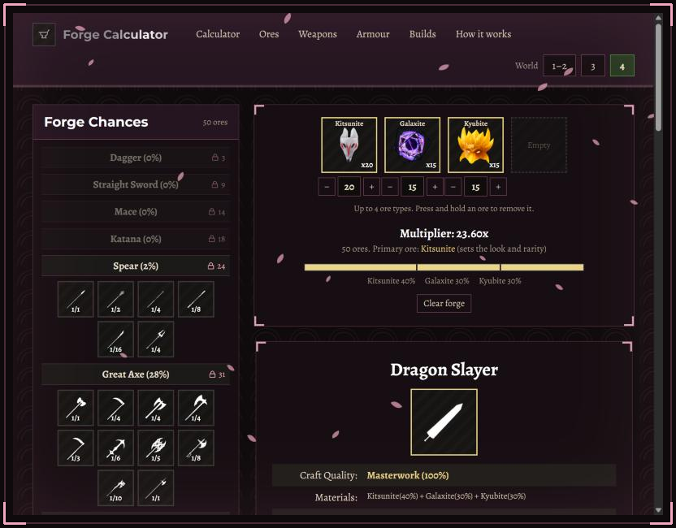
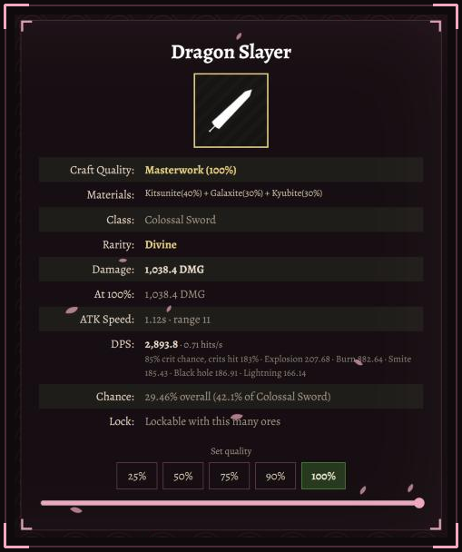
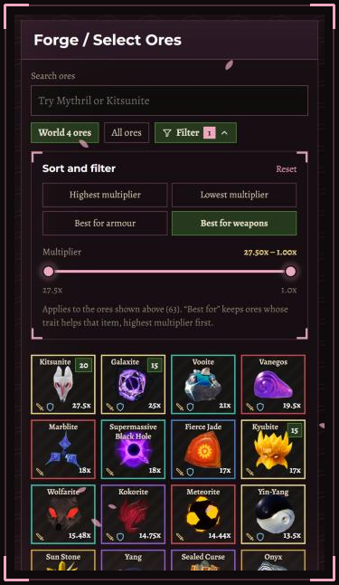
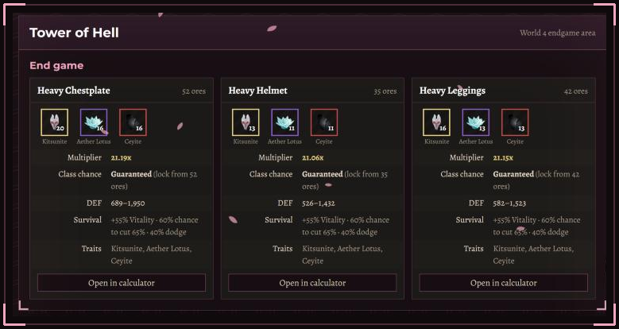
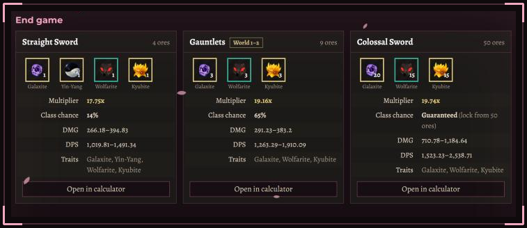
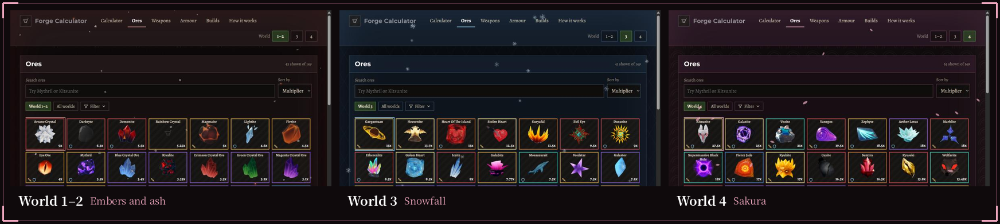
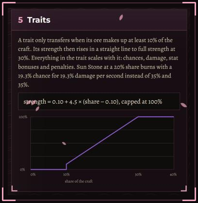

<p align="center">
  <a href="https://the-forge-calculator.vercel.app"></a>
</p>

<p align="center">
  <a href="https://the-forge-calculator.vercel.app"></a>
</p>
<p align="center">
  
  
  
  
  
  
</p>

<p align="center"></p>

## 壱 · What is this?

**Forge Calculator** is a free website for the Roblox game **[The Forge](https://www.roblox.com/discover?Keyword=The%20Forge)**. In the game you mine ores, throw them into the forge and hope for a good weapon or piece of armour. Every craft costs ores you spent hours mining, and the result is random.

This site takes the guesswork out. Put in the ores you are thinking of using and it shows you, before you craft:

- **what can come out**: every weapon or armour class, every variant inside it, and how likely each one is;
- **how strong it will be**: the exact damage or defence at any craft quality, and at every enhancement level from +0 to +10;
- **which traits carry over**: and how strong each trait will be at your mix;
- **how hard a weapon really hits**: damage per second with crits, attack speed, burns, explosions and every other trait counted;
- **what to craft next**: the best armour for each world and stage, worked out by trying every combination of ores.

<p align="center">
  <a href="https://the-forge-calculator.vercel.app/?o=kitsunite:20,galaxite:15,kyubite:15&k=weapon&world=4&q=100"></a>
  <br><sub>A World 4 weapon from Kitsunite, Galaxite and Kyubite. Click the picture to open this exact craft.</sub>
</p>

<p align="center"></p>

## 弐 · Features

<table>
<tr>
<td width="46%" valign="top"></td>
<td valign="top">

###  The forge, exactly like the game

- **Up to 4 ore types**, any amount of each, just like the in-game forge. Press and hold an ore to remove all of it at once.
- **Forge chances** for every class from 3 to 55 ores, with the ore count where you can lock each class.
- **Every variant** in a class with its 1-in-N weight and overall chance. Click one to see its stats.
- **Damage or defence** at any craft quality (25% to 100%), plus a table for every enhancement level.
- **Rarity and primary ore**, which set how the item looks.

###  DPS that counts your traits

Every weapon shows **damage per second**, and it counts what the ores add: crit chance and crit damage, lethality, attack speed, explosions, burn, poison, smite, Galaxite black holes and lightning. The card lists what each one adds, so you can see why one mix beats another.

</td>
</tr>
<tr>
<td valign="top">

###  Traits at their real strength

A trait only carries over when its ore is at least **10%** of the craft, and it only reaches full strength at **30%**. The calculator scales every number in the trait to your mix, so a Sun Stone at a 20% share shows its real 19.3% burn, not the 35% printed on the ore.

###  A quick ore picker

- Shows the ores of the world you are in, or all 149.
- Search by name, sort by **highest or lowest multiplier**, or keep only ores that are **best for armour** or **best for weapons**.
- A two-handle **multiplier slider** narrows the list to the range you can afford.
- Small sword and shield marks show at a glance which ores help weapons and which help armour.

</td>
<td width="40%" valign="top"></td>
</tr>
</table>

###  Builds: what to craft in each world

The **Builds** page recommends a weapon and a full set of Heavy armour for every world and stage of the game, from early game to the Tower of Hell.

- **Armour is computed, not copied.** A search script tries every mix of up to 4 ores you can realistically have by that stage and keeps the one with the most effective health: defence from the multiplier, plus Vitality, damage-reduction shields and dodge.
- Every armour recipe uses the ore count that **locks the Heavy class**, so the piece is guaranteed.
- Each card shows the multiplier, the class chance, the damage or defence range, the DPS, the traits and a **Survival** line that explains why the mix wins.
- **Open in calculator** loads the whole craft as a ready-made forge, already on the right world, class and weapon. Gauntlet builds open as Dark Knight's Gauntlets.

<p align="center">
  
  <br><br>
  
</p>

###  One site, three worlds

Pick your world at the top and the whole site follows: the ores, the weapon classes (World 1–2 has Gauntlets, Katana and Greatsword; World 3 has Mace, Axe and Spear; World 4 has Mace, Katana and Spear), the variants, the Funguy shop blueprints and the World 4 Halloween weapons. Each world has its own look, too.

<p align="center">
  
</p>

###  And more

- **Share any craft.** The ores, item type, quality and world are saved in the address, so a link opens the exact same forge. Your last craft is remembered too.
- **Ores, Weapons and Armour pages** list every item with its world, unlock count, variants, stats and traits.
- **How it works** explains every formula in plain words, with a chart of how trait strength grows with your share.
- **Works on phones.** The forge and ore picker come first on small screens.
- **Fast.** Ore taps, world switches and filters respond straight away, even on slower devices.

<p align="center"></p>

<p align="center"></p>

## 参 · Why use this one?

| | |
| --- | --- |
| **Built from real crafts** | The formulas are tested against items crafted in the game: a Dark Knight Chestplate at 12.51x is 626 defence, a Hachiwari at 10.88x is 179.52 damage. The automated tests check these on every change. |
| **Per-world pools** | Weapon classes and variants change between worlds. This calculator only shows what can actually come out in the world you are in. |
| **The real 4-ore forge** | The forge holds 4 ore types, just like the game, so you can't plan a craft you can't make. |
| **Traits at your share** | Traits are scaled to how much of each ore you use, instead of always showing their full strength. |
| **DPS with traits** | Damage per second counts crits, attack speed and every proc, not just the base damage. |
| **Builds you can trust** | Armour builds come from a search over every combination, and the data is checked ore by ore against the wiki. |
| **Free and open** | No login, no ads, no download. The code is open, and corrections are welcome. |

<p align="center"></p>

## 肆 · How it is built

Next.js (App Router, TypeScript), hosted on Vercel. Game data and images live in Supabase.

1. `docs/PRD.md` holds every ore, trait, weapon, armour piece and odds table.
2. `npm run data:build` turns it into `data/catalogue.json`, with a revision number that goes up whenever the data changes.
3. The same JSON is published to the Supabase table `catalogue_releases`. The site reads the newest release (cached for an hour), unless the copy bundled with the deploy is newer.
4. Images are in the Supabase Storage bucket `forge-images`. Anything missing shows a striped placeholder tile.
5. `npm run builds:armour` re-runs the armour search and writes `data/armour-builds.json`.

### Run it locally

```sh
npm ci
npm run dev        # http://localhost:3000
npm run check      # lint, typecheck, tests and a production build
```

No environment variables are needed: the app reads the public, read-only Supabase project, and falls back to the bundled `data/catalogue.json` if Supabase can't be reached. To use another project, set `NEXT_PUBLIC_SUPABASE_URL` and `NEXT_PUBLIC_SUPABASE_ANON_KEY` (see `.env.example`).

See [FILES.md](FILES.md) for what every file does.

<p align="center"></p>

## 伍 · The rules the calculator uses

| Rule | Formula |
| --- | --- |
| Forge slots | Up to 4 different ore types per craft, any amount of each |
| Multiplier | M = sum(multiplier × count) ÷ total ores |
| Class odds | Look up the total ore count (3 to 55) in the odds table; above 55 use the 55 row |
| Variant odds | (1 ÷ N) ÷ sum(1 ÷ N) inside the class |
| World pools | Slots 3–5 are Gauntlets/Katana/Greatsword in World 1–2, Mace/Axe/Spear in World 3, Mace/Katana/Spear in World 4; each world has its own variants, plus Funguy shop blueprints and the World 4 Halloween weapons |
| Primary ore | Largest count; ties go to the higher multiplier. Sets the look and rarity |
| Traits | Need a 10% share; strength = 0.10 + 4.5 × (share − 0.10), full at 30%. Chances, damage and stat amounts all scale |
| Defence | round(2 × health % × M × quality) |
| Damage | 2 × base damage × M × quality, rounded to 2 decimals |
| Enhancement | stat × (1 + 0.05 × level), +0 to +10 |
| DPS | damage × (1 + lethality) × crit blend × hits per second, plus explosion, burn, poison, smite, black hole and lightning. Hits per second = (1 + attack speed) ÷ swing time; crit blend = chance × (1.45 + crit damage) + (1 − chance) |
| Armour score | multiplier × (1 + Vitality) ÷ (1 − shield chance × cut) ÷ (1 − dodge), using the best shield and the best dodge |

<p align="center"></p>

## 陸 · Credits

Fan-made, and not affiliated with the game's developers or Roblox. Game data and images come from the community [Forge Wiki](https://forgewiki.org/wiki/The_Forge_wiki) (CC BY-SA 4.0), checked against crafts made in the game. Found a mistake? [Open an issue](https://github.com/1920m/Forge-Calculator/issues).

<p align="center"><sub>鍛 · Plan every craft before you smelt it.</sub></p>
